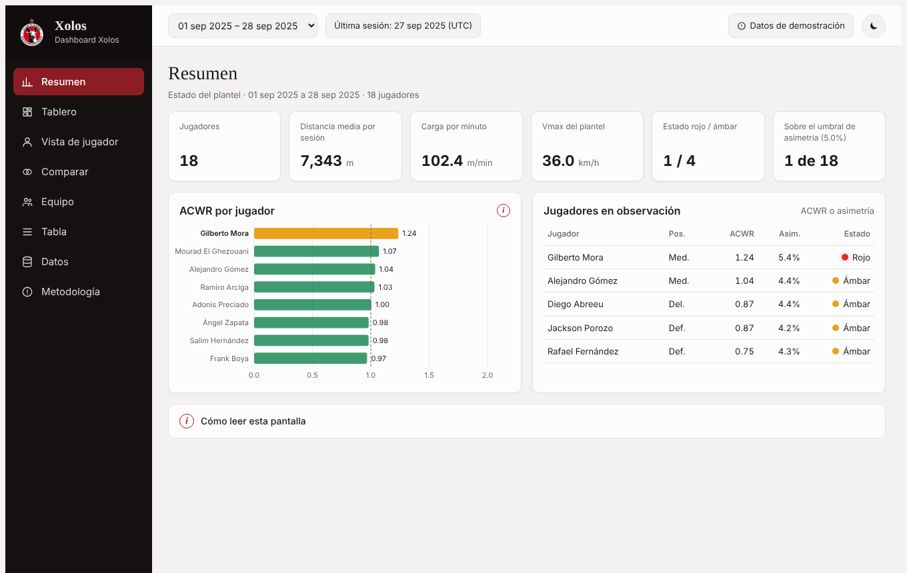

# Dashboard Xolos · Rendimiento físico y factores de riesgo de lesión

Prototipo interactivo del dashboard del proyecto
*Propuesta de dashboard para la visualización del rendimiento físico y el monitoreo de factores de riesgo de lesión en el Club Tijuana (Xolos)*.

> **Datos simulados.** Todas las métricas de carga y movimiento son generadas por un script y **no corresponden a mediciones reales**
> de ningún jugador. Lo que se demuestra es la lógica del tablero (cómo se calculan los indicadores, cómo se filtran y cómo se leen),
> no el estado físico de la plantilla. El dashboard **describe, no predice**: no calcula la probabilidad de lesión.




## Qué incluye

| Pestaña | Contenido |
|---|---|
| **Resumen** | Estado del plantel, ACWR por jugador y jugadores en observación. |
| **Tablero** | Los 10 KPI (K1–K10) en tres bloques (carga, intensidad, movimiento), 4 gráficos del documento, 3 segmentadores (jugador, semana/sesión, tipo de entrenamiento) y umbral de asimetría editable. |
| **Vista de jugador** | Carga y ACWR, asimetrías, histograma de Vmax, zonas de calor, radar y comparación contra su posición y su línea base de 28 días. |
| **Comparar** | Dos jugadores lado a lado (tabla, ACWR y asimetría). |
| **Equipo** | Tabla del plantel ordenada por estado (rojo, ámbar, verde). |
| **Tabla** | Registros por jugador y sesión; copia como CSV. |
| **Datos** | Carga de CSV, validaciones, bitácora de limpieza, diccionario de 17 variables. |
| **Metodología** | Resumen del documento: alcance, KPI, definiciones y equivalencias con las hojas del Excel. |

Además: modo claro/oscuro, animaciones que respetan `prefers-reduced-motion`, ayuda «i» por gráfico y por pantalla, navegación por teclado en los gráficos y diseño adaptable a móvil.


## Estructura del repositorio

```
index.html        Dashboard completo (HTML, CSS y JavaScript en un archivo)
data/             CSV de ejemplo y plantilla
docs/             Capturas de pantalla
```

## Autoría y avisos

- Los nombres, dorsales, posiciones y fechas de nacimiento provienen de la página pública del primer equipo (xolos.com.mx); las fotos y el escudo pertenecen al Club Tijuana. Se usan con fines académicos y sin relación con el club. 
